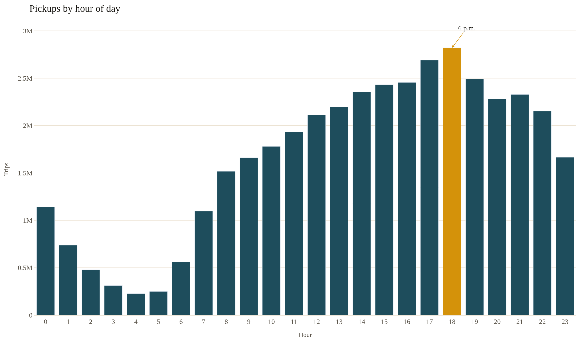
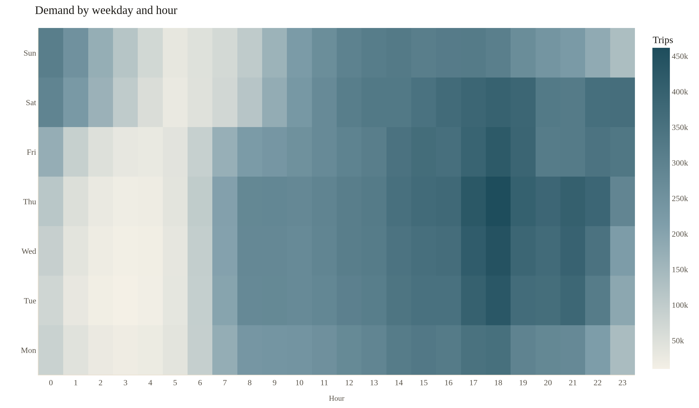
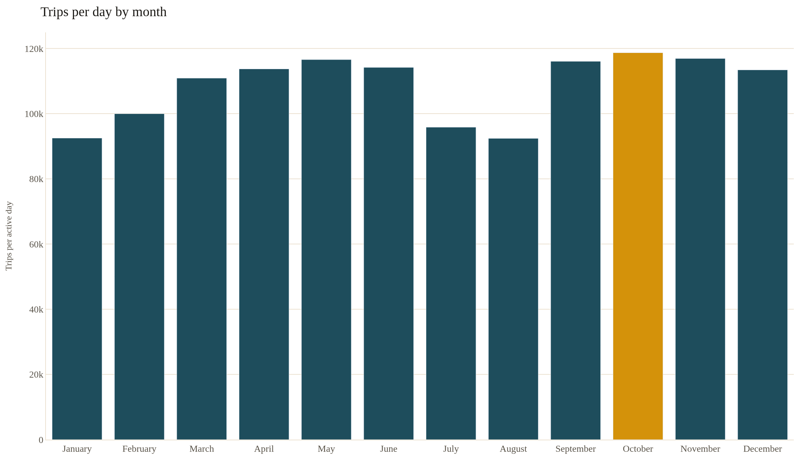
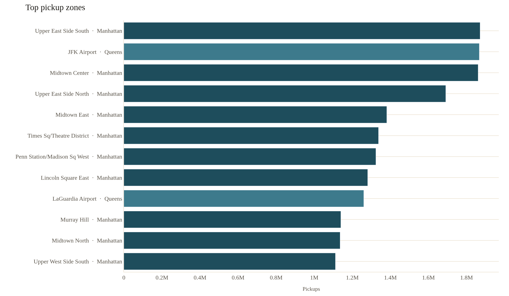
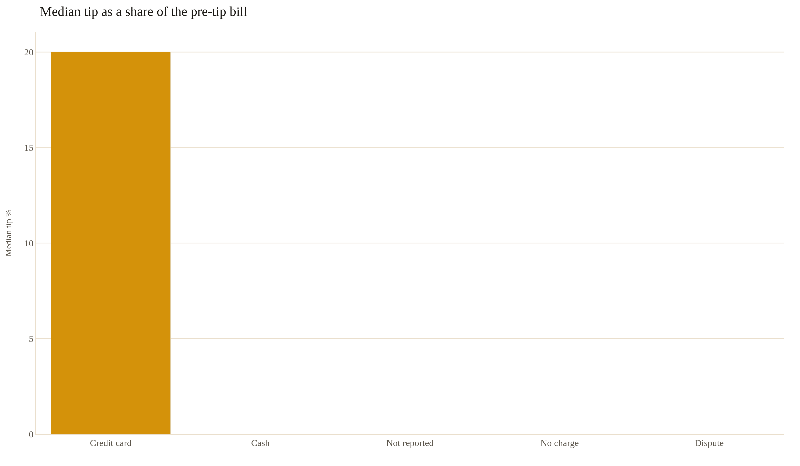
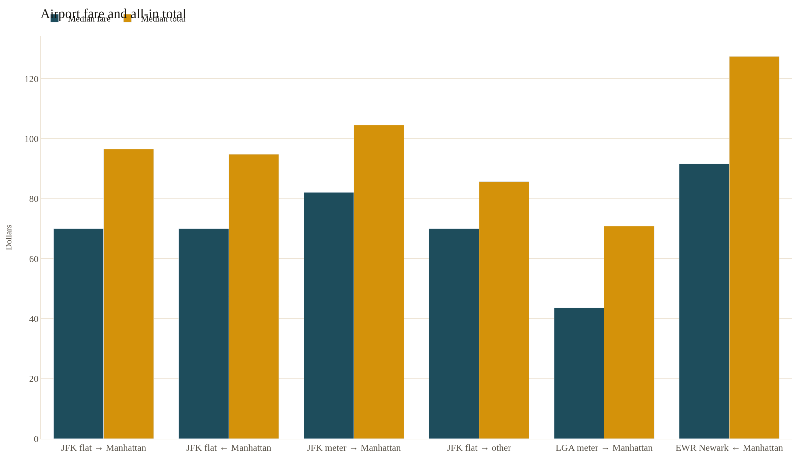
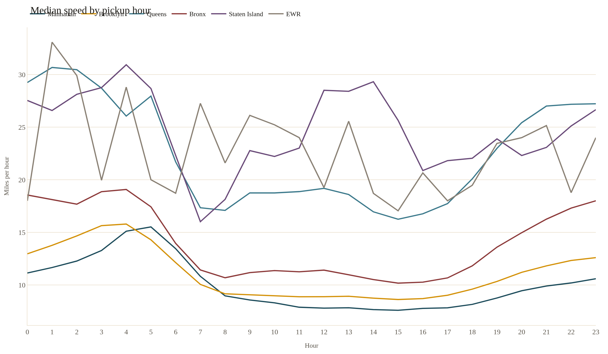
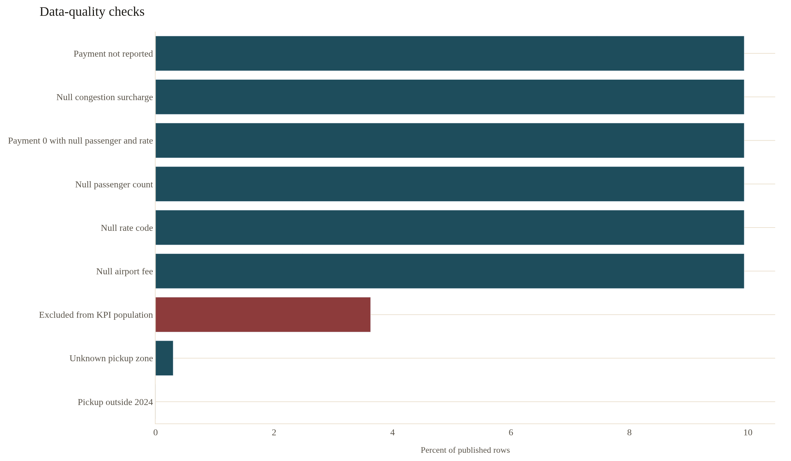
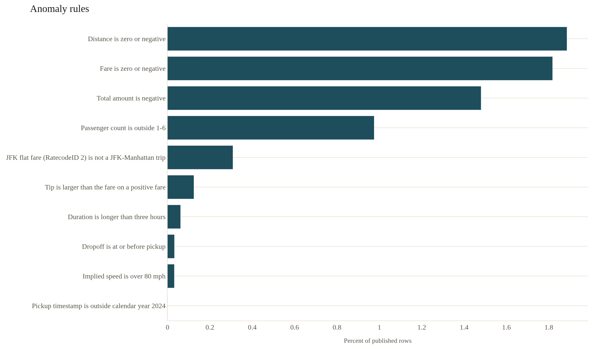

# Insights: NYC yellow taxi, 2024

These eight findings are computed from the TLC yellow trip records for calendar year 2024. DuckDB reads the monthly Parquet files directly. The SQL is in [`sql/`](sql/). Every count, rate, and dollar figure below is taken from that output. Nothing here is a placeholder.

The in-policy population is defined in [`sql/00_population.sql`](sql/00_population.sql): a 2024 pickup, a completed trip of at most three hours, distance between 0 and 100 miles, fare between $0 and $300, and a positive total. That keeps **39,675,278** trips out of **41,169,720** published rows. The same population sits behind the [live dashboard](https://naveecode.github.io/nyc-taxi-insights/).

Reproduce the extracts with `make data && make report`.

| # | Finding | Number |
| --- | --- | --- |
| 1 | Demand peaks at 6 p.m. | 6 p.m. accounts for 7.1% of in-policy trips (2,821,218). |
| 2 | October is the busiest month per day | October runs 118,688 in-policy trips per day, 1.28× August. |
| 3 | Pickups concentrate at Upper East Side South | Upper East Side South (Manhattan) is 4.7% of pickups, and the top 10 zones are 37.9%. |
| 4 | The median card tip is 20% | The median credit-card tip is 20% of the pre-tip bill ($3.26). |
| 5 | The JFK flat fare to Manhattan is $70 | JFK to Manhattan is a $70 median fare ($96.55 all-in) over 18.2 mi. |
| 6 | Manhattan is slowest at 3 p.m. | Manhattan at 3 p.m. moves at 7.6 mph (2,144,940 trips). |
| 7 | 9.9% of rows are one incomplete vendor feed | 4,091,232 rows (9.9%) are one incomplete vendor feed. Trip filters drop only 3.6%. |
| 8 | Largest anomaly: distance is zero or negative | Distance is zero or negative flags 776,305 rows (1.9% of the file). |

## 1. Demand peaks at 6 p.m.

**Question.** When do yellow cabs actually get busy, and is that peak the same all week?

**Query.** [`sql/02_hourly_demand.sql`](sql/02_hourly_demand.sql), [`sql/08_demand_heatmap.sql`](sql/08_demand_heatmap.sql)

**Chart.**

**Number.** 6 p.m. accounts for 7.1% of in-policy trips (2,821,218).

Across 39,675,278 in-policy trips, the busiest clock hour is 6 p.m. That is 1.86× the 8 a.m. hour (1,517,223 trips). The top three hours (5 p.m., 6 p.m., 7 p.m.) are 20.2% of demand. The quietest hour is 4 a.m., with 226,800 trips (0.6%). Monday, Tuesday, Wednesday, Thursday, Friday, Saturday peak at 6 p.m.; Sunday peak at 2 p.m.

**Recommendation.** Staff street hail and dispatch for 6 p.m. Keep the 6 p.m. roster for Monday, Tuesday, Wednesday, Thursday, Friday, Saturday, and shift Sunday toward 2 p.m. The quietest hour is only 0.6% of the year, so a flat headcount across 24 hours overstaffs the night.

## 2. October is the busiest month per day

**Question.** Which month is actually the busiest once month length is taken out?

**Query.** [`sql/09_monthly_volume.sql`](sql/09_monthly_volume.sql)

**Chart.**

**Number.** October runs 118,688 in-policy trips per day, 1.28× August.

October has 31 active pickup days and 3,679,323 in-policy trips. August has 31 active days and 2,864,741 trips, or 92,411 per day. October also leads on total trips (3,679,323). The per-day rate is the fair comparison: months do not have the same length, and 2024 is a leap year.

**Recommendation.** Set the annual run rate from the full year, not from a single extract. A plan sized to August covers 77.9% of October's daily volume. Compare months on trips per day before calling a change seasonal.

## 3. Pickups concentrate at Upper East Side South

**Question.** How concentrated is pickup demand across taxi zones?

**Query.** [`sql/03_zone_rankings.sql`](sql/03_zone_rankings.sql)

**Chart.**

**Number.** Upper East Side South (Manhattan) is 4.7% of pickups, and the top 10 zones are 37.9%.

Upper East Side South produced 1,871,205 in-policy pickups, 5.3% of all Manhattan pickups. Second is JFK Airport in Queens (1,867,060 pickups, 4.7% of the city, 51.3% of Queens). Manhattan is 89.1% of all pickups. The two airports are 85.9% of Queens pickups. The running share in sql/03_zone_rankings.sql reaches 37.9% by city rank 10, out of 262 zones with a known borough.

**Recommendation.** Stage vehicles for Upper East Side South and the other nine zones inside that 37.9% share before spreading coverage evenly. Use borough rank from the same query when a zone is the main stand in its borough without cracking the citywide top 10.

## 4. The median card tip is 20%

**Question.** What share of the bill do riders tip, and can cash trips be included?

**Query.** [`sql/04_tip_by_payment.sql`](sql/04_tip_by_payment.sql)

**Chart.**

**Number.** The median credit-card tip is 20% of the pre-tip bill ($3.26).

Credit-card trips are 76% of the tip population (30,167,120 trips). A tip is present on 94.4% of them, the median tip percent is 20%, and the mean is 17.6%. Cash records a median tip of $0 and a tip on 0.0051% of trips. That is a recording gap, not a measurement of cash generosity. Payment type 0 (9.3% of this population) has a median tip percent of 0% and a tip on 17.1% of trips, so it is not a stand-in for cash.

**Recommendation.** Publish tip rate from credit-card trips only. Treat cash tip fields as unobserved. Keep payment type 0 out of both groups: the payment field itself was not reported, and pooling it with cash would mix a partial tip signal into a column that is otherwise empty.

## 5. The JFK flat fare to Manhattan is $70

**Question.** What does the JFK flat fare actually cost, and where is it being misapplied?

**Query.** [`sql/05_airport_economics.sql`](sql/05_airport_economics.sql), [`sql/07_anomaly_rules.sql`](sql/07_anomaly_rules.sql)

**Chart.**

**Number.** JFK to Manhattan is a $70 median fare ($96.55 all-in) over 18.2 mi.

The flat-fare product to Manhattan covers 969,304 in-policy trips. Median distance is 18.2 mi, median time is 50 minutes, and median fare per mile is $3.85. The return, Manhattan to JFK, is 284,409 trips at the same median fare of $70 and an all-in median of $94.80. Metered JFK-to-Manhattan trips are uncommon next to the flat fare (14,944 versus 969,304) and cost more: median fare $82.10 against $70. In-policy JFK flat trips that drop off outside Manhattan still show a median fare of $70 (8,041 trips, median 16.6 mi), and 10.2% of that slice is under 5 miles. The anomaly rule counts 127,156 published rows where rate code 2 is not a JFK–Manhattan pair. LaGuardia to Manhattan is metered: median fare $43.60, median total $70.89, median tolls $6.94, median tip $11.15, over 9.5 mi. Newark from Manhattan, on the Newark rate, is the expensive product: median fare $91.60, median total $127.42, 17.7 mi, 83,258 trips.

**Recommendation.** Quote the JFK–Manhattan flat fare as $70 on the meter and about $96.55 all-in, for a ride of about 18.2 mi. Audit rate code 2 when the other end is not Manhattan: those trips still carry a $70 median fare, including a 10.2% share under 5 miles. For LaGuardia to Manhattan, quote the all-in median ($70.89), not the meter fare alone ($43.60).

## 6. Manhattan is slowest at 3 p.m.

**Question.** Where and when does a yellow cab actually slow down?

**Query.** [`sql/06_speed_by_hour_borough.sql`](sql/06_speed_by_hour_borough.sql)

**Chart.**

**Number.** Manhattan at 3 p.m. moves at 7.6 mph (2,144,940 trips).

Among borough-hours with at least 1,000 in-policy trips, the slowest median is Manhattan at 3 p.m. (7.6 mph) and the fastest is Queens at 1 a.m. (30.7 mph), a 23.1 mph gap. Inside Manhattan the median runs from 15.5 mph at 5 a.m. to 7.6 mph at 3 p.m. Speeds above 80 mph are excluded here and counted in the anomaly rules, so a few broken timestamps cannot set the median.

**Recommendation.** Pad scheduled pickups from the borough-hour median. A citywide average hides the 23.1 mph gap between Manhattan at 3 p.m. and Queens at 1 a.m. For Manhattan appointments, the slow window is 3 p.m. (7.6 mph), not the early morning (5 a.m., 15.5 mph).

## 7. 9.9% of rows are one incomplete vendor feed

**Question.** How much of the published file is usable, and what is the main hole?

**Query.** [`sql/01_data_quality.sql`](sql/01_data_quality.sql), [`sql/00_population.sql`](sql/00_population.sql)

**Chart.**

**Number.** 4,091,232 rows (9.9%) are one incomplete vendor feed. Trip filters drop only 3.6%.

The files contain 41,169,720 published rows. 39,675,278 survive the in-policy definition in sql/00_population.sql (1,494,442 excluded, 3.6%). Six checks flag the same 4,091,232 rows (9.9%). The fields move together: payment_type 0, null passenger_count, null RatecodeID, null congestion surcharge, and null airport fee. The intersection of payment type 0 with the two null trip fields is that same count, so it is one feed rather than five separate problems. At least 2,596,790 of those incomplete rows still pass the trip filters, because the feed is larger than the excluded set even if every excluded row belonged to it. Pickups outside 2024 are rare: 56 rows.

**Recommendation.** Split the payment_type 0 feed out before any passenger-count, rate-code, airport-fee, or congestion analysis. Those fields are missing together, not zero. Keep the rows in demand and zone counts when distance and duration pass the population filters, and print the trip-filter exclusion (3.6%) next to every KPI.

## 8. Largest anomaly: distance is zero or negative

**Question.** Which implausible values will move a fare, speed, or tip average?

**Query.** [`sql/07_anomaly_rules.sql`](sql/07_anomaly_rules.sql)

**Chart.**

**Number.** Distance is zero or negative flags 776,305 rows (1.9% of the file).

The rules are applied to every published row, and a row can trip more than one. Non-positive distance flags 776,305 (1.9%). Non-positive fare flags 748,284 (1.8%). Implied speed over 80 mph flags 13,245 (0.03%). JFK flat fares that are not JFK–Manhattan trips flag 127,156 (0.3%). The query's share-of-flags column divides by the sum of flags, so those shares are not a partition of trips and should not be added into a bad-row rate.

**Recommendation.** Exclude these rules before any average of fare per mile, speed, or tip. Start with nonpositive_distance: it is the largest count. Do not add the flag rates together. Review the JFK flat-fare rule on its own before quoting the airport product; it marks 127,156 rows that are not the Manhattan flat fare.
