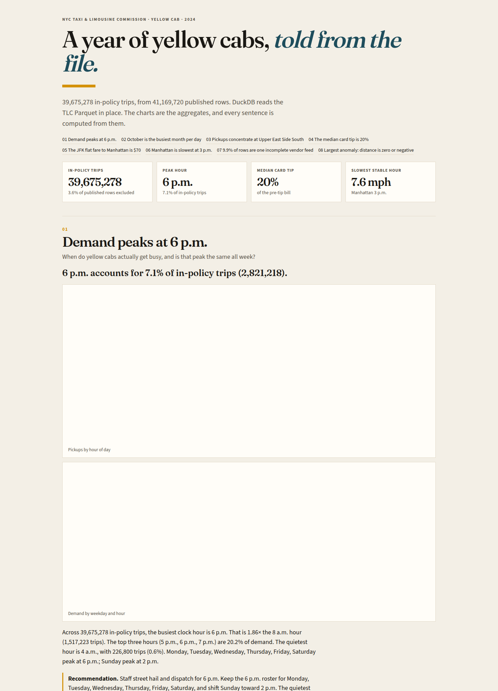

# NYC yellow taxi, 2024

What a year of yellow cabs actually did: when people ride, where trips start, what they tip, what the airports cost, and which rows should never enter an average.

**[Live dashboard](https://naveecode.github.io/nyc-taxi-insights/)** · source notes in [INSIGHTS.md](INSIGHTS.md)

[](https://github.com/naveecode/nyc-taxi-insights/actions/workflows/ci.yml)

The public TLC yellow trip files for calendar 2024 hold **41,169,720** rows. **39,675,278** pass the filters below. DuckDB queries the Parquet in place. Pandas and Plotly draw the notebooks and the static dashboard.

## Findings

Each one is a question, the SQL that answers it, a chart, the number, and a recommendation. Full write-up: [INSIGHTS.md](INSIGHTS.md).

| | Question | Number |
| --- | --- | --- |
| 1 | When do trips peak? | **6 p.m.** is 7.1% of in-policy trips. Sunday peaks at 2 p.m.; every other day peaks at 6 p.m. |
| 2 | Which month is busiest per day? | **October**, 118,688 trips a day, 1.28× August. |
| 3 | How concentrated are pickups? | **Upper East Side South**. The top 10 zones are 37.9%. Manhattan is 89% of pickups. |
| 4 | What do people tip? | The median **credit-card tip is 20%** of the pre-tip bill. Cash tips are not in the file. |
| 5 | What does the JFK flat fare cost? | **$70** median fare, **$96.55** all-in, over 18.2 miles to Manhattan. |
| 6 | When is the city slow? | **Manhattan at 3 p.m., 7.6 mph**, on 2.1 million trips. |
| 7 | What is missing? | **9.9%** of rows are one vendor feed with payment, passenger, rate, congestion, and airport fee all blank. |
| 8 | What will break an average? | **776,305** rows have distance at or below zero. |

## Dashboard

[site/index.html](site/index.html) is a single static page. Plotly is inlined, so GitHub Pages publishes the file as-is. The same charts are saved under [docs/figures/](docs/figures/) for the write-up.



## Run it

Python 3.12.

```bash
python -m venv .venv
source .venv/bin/activate
pip install -e ".[dev]"
make check          # ruff + pytest, using the committed 10k-row sample
```

Rebuild the full-year extracts, figures, dashboard, and INSIGHTS.md:

```bash
make data           # public Parquet for Jan–Dec 2024, plus the zone lookup (~700 MB)
make report
```

`make data` downloads:

- `https://d37ci6vzurychx.cloudfront.net/trip-data/yellow_tripdata_2024-01.parquet` through `2024-12`
- `https://d37ci6vzurychx.cloudfront.net/misc/taxi_zone_lookup.csv`

The raw files stay in `data/raw/` and are not committed. Tests and CI never download them.

Notebooks in [notebooks/](notebooks/) use pandas and Plotly. They recompute the shapes on the 10k sample and plot the published full-year extracts in `data/agg/`.

## Method

DuckDB reads the monthly Parquet files through a `trips` view. `sql/00_population.sql` is the in-policy cut used for demand, zones, tips, airports, speed, and month:

- pickup timestamp in calendar 2024
- duration from 1 second through 3 hours
- distance in (0, 100] miles
- fare in (0, 300]
- total amount greater than zero

Data-quality and anomaly queries scan every published row, on purpose. Tip percent is `tip_amount / (total_amount - tip_amount)`. The JFK flat fare is rate code 2. Airports are zone 132 (JFK), 138 (LaGuardia), and 1 (Newark). Speed medians keep 0.5–80 mph, and the slowest-hour callout requires at least 1,000 trips in that borough-hour.

The analytical queries use CTEs and window functions: shares, running totals, ranks, and lags. See [sql/](sql/).

## Layout

| Path | Role |
| --- | --- |
| `sql/` | Query library |
| `src/taxi_insights/` | Download, DuckDB connection, aggregates, charts, narrative |
| `data/sample/` | Committed 10,000-row sample and zone lookup |
| `data/agg/` | Full-year aggregates the dashboard is built from |
| `notebooks/` | Pandas and Plotly |
| `docs/figures/` | Static charts |
| `site/` | Dashboard published by GitHub Pages |
| `tests/` | Sample queries, crafted anomaly rows, and a check that the write-up matches the extracts |

## Tests

`pytest` runs against the committed sample and a dozen hand-built rows that must trip specific anomaly rules. A separate test checks that the dashboard and INSIGHTS.md still match `data/agg/`. CI installs the package, runs ruff, and runs pytest. It does not download the year.

## Data

New York City Taxi & Limousine Commission, Yellow Taxi Trip Records, calendar year 2024, and the taxi zone lookup. Public files, no account required. [TLC trip record data](https://www.nyc.gov/site/tlc/about/tlc-trip-record-data.page).
